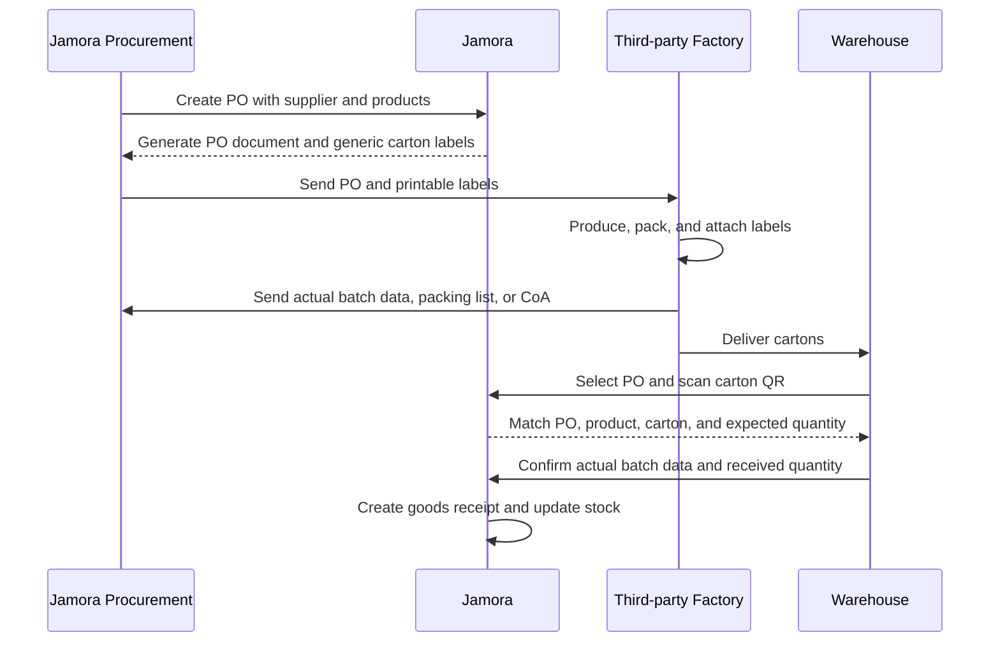
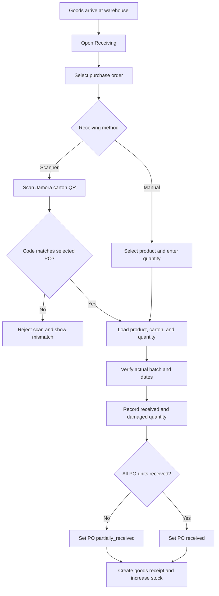
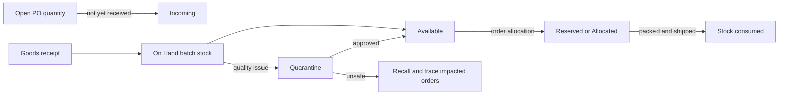
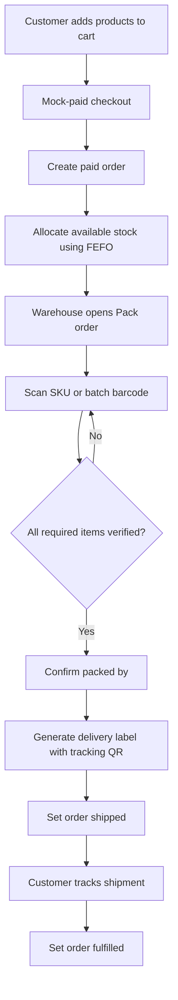
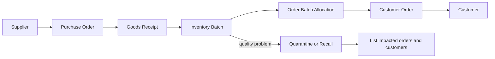
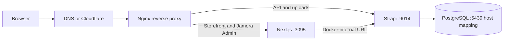
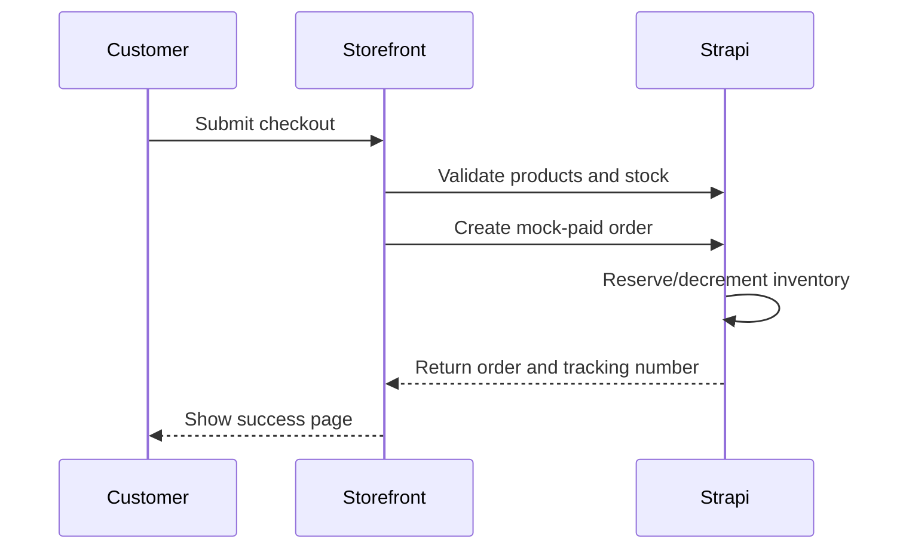
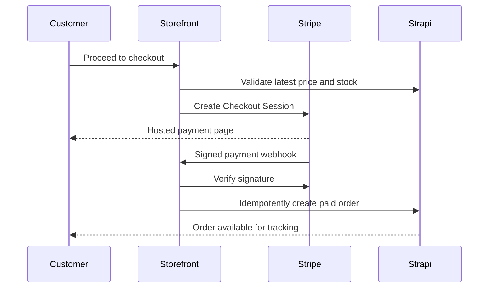

# Jamora - Business Flow & Flowcharts

Dokumen ini menjelaskan alur bisnis Jamora untuk fase demo, mulai dari pengadaan
barang ke pabrik pihak ketiga, penerimaan stok, penjualan, packing, pengiriman,
hingga traceability batch.

> **Batas fase demo:** checkout dianggap berhasil dibayar melalui mock-paid
> checkout. Integrasi pembayaran Stripe nyata dan webhook otomatis belum aktif.

## 1. System Overview

| Layer | Tool | Fungsi |
| --- | --- | --- |
| Storefront | Next.js | Katalog, cart, mock checkout, tracking customer |
| Jamora Admin | Next.js `/admin` | Operasional produk, order, supplier, PO, receiving, inventory, dan analytics |
| Backend / CMS | Strapi | API dan penyimpanan data bisnis |
| Database | PostgreSQL | Produk, order, supplier, PO, receipt, batch, dan audit log |
| Reverse proxy | Nginx | Satu domain untuk storefront, admin, dan API |
| Payment fase berikutnya | Stripe Checkout | Pembayaran nyata dan konfirmasi webhook |

## 2. Actors and Responsibilities

| Actor | Tanggung jawab |
| --- | --- |
| Store Owner / Admin | Produk, supplier, promosi, content, analytics, dan konfigurasi |
| Procurement | Membuat PO dan mengirim dokumen serta label logistik ke supplier |
| Third-party Factory | Produksi, memberi batch aktual, production date, expiry date, CoA, dan menempel label |
| Warehouse / Receiving | Memilih PO, scan carton, verifikasi barang, lalu menerima stok |
| Packing Team | Mengambil order paid, scan SKU/batch, packing, dan membuat delivery label |
| Customer | Belanja, checkout, dan melacak order |

## 3. End-to-End Business Flow

1. Admin membuat supplier dan menghubungkan produk yang dapat diproduksi supplier tersebut.
2. Procurement membuat purchase order untuk satu supplier dengan satu atau beberapa produk.
3. Jamora membuat dokumen PO dan label logistik generik untuk setiap carton.
4. PO dan file label dikirim ke pabrik pihak ketiga.
5. Pabrik memproduksi barang, mencetak/menempel label Jamora, dan mencatat data batch aktual.
6. Pabrik mengirim barang beserta packing list atau CoA.
7. Warehouse membuka menu **Receiving**, memilih PO, lalu scan label carton atau input manual.
8. Data batch aktual diverifikasi dari label pabrik, packing list, atau CoA.
9. Receipt disimpan; stok dan batch inventory bertambah sesuai jumlah yang benar-benar diterima.
10. Produk aktif dan stok tersedia ditampilkan di storefront.
11. Customer membuat order melalui mock-paid checkout selama fase demo.
12. Tim warehouse memproses order, scan item, packing, membuat delivery label, lalu mengirimnya.
13. Customer melacak order menggunakan order number atau tracking number.
14. Batch yang bermasalah dapat di-trace, dikarantina, atau di-recall dari Jamora Admin.

```mermaid
flowchart LR
    A[Admin manages products and suppliers] --> B[Procurement creates PO]
    B --> C[Jamora generates PO and generic carton labels]
    C --> D[Third-party factory produces goods]
    D --> E[Factory supplies actual batch data and CoA]
    E --> F[Warehouse selects PO in Receiving]
    F --> G[Scan carton label or enter quantity manually]
    G --> H[Verify batch, production date, and expiry date]
    H --> I[Post goods receipt]
    I --> J[Stock and batch inventory increase]
    J --> K[Product available on storefront]
    K --> L[Customer places paid demo order]
    L --> M[Warehouse scans and packs order]
    M --> N[Generate delivery label and ship]
    N --> O[Customer tracks and receives order]
```

## 4. Procurement and Factory Flow

### 4.1 Purchase Order

Satu PO hanya memiliki satu supplier, tetapi dapat berisi beberapa produk dan
beberapa line item. Informasi utama PO:

- PO number
- supplier
- expected delivery date
- product / SKU
- ordered quantity
- units per carton
- notes atau dokumen pendukung

Status PO:

| Status | Arti |
| --- | --- |
| `draft` | PO masih disiapkan |
| `ordered` | PO sudah dikirim ke supplier |
| `in_transit` | Opsional; supplier menyatakan barang sedang dikirim |
| `partially_received` | Sebagian barang sudah diterima |
| `received` | Seluruh kuantitas PO sudah diterima |
| `cancelled` | PO dibatalkan |

Status `in_transit` bukan syarat receiving. Warehouse dapat menerima langsung
dari PO berstatus `ordered` apabila barang sudah datang.

### 4.2 Two-label Model

Jamora menggunakan dua label dengan fungsi yang berbeda:

| Label | Dibuat oleh | Isi | Fungsi |
| --- | --- | --- | --- |
| Jamora logistics label | Jamora | PO, SKU/product ID, carton number, quantity, QR | Identifikasi carton dan scan receiving |
| Factory batch label | Pabrik | Batch aktual, production date, expiry date, informasi legal | Identitas produksi dan kepatuhan produk |

Dalam flow operasional yang disepakati, **label logistik generik Jamora tidak
memuat production date dan expiry date**. Tanggal tersebut harus berasal dari
hasil produksi aktual pabrik, bukan estimasi saat PO dibuat. QR Jamora berfungsi
sebagai identitas logistik dan penghubung carton ke PO.

> **Catatan implementasi demo saat ini:** payload QR carton hanya membawa PO,
> product ID, batch, carton, dan quantity. Namun form PO dan tampilan label cetak
> masih meminta serta menampilkan batch, production date, dan expiry date yang
> direncanakan. Nilai tersebut wajib diverifikasi terhadap label/CoA pabrik saat
> receiving. Pemisahan penuh menjadi label logistik generik dan label batch
> pabrik adalah penyelarasan berikutnya.

## 5. Receiving Flow

Receiving dilakukan dari menu **Receiving**, bukan dari Batches & Expiry.

1. Cari dan pilih PO yang barangnya datang.
2. Cocokkan supplier, produk, dan outstanding quantity.
3. Scan QR carton dengan USB scanner/kamera, atau pilih input manual.
4. Sistem mencocokkan kode dengan PO dan mencegah carton yang tidak sesuai.
5. Verifikasi quantity received dan damaged quantity.
6. Verifikasi batch number, production date, dan expiry date berdasarkan data aktual pabrik.
7. Isi nama penerima dan catatan jika diperlukan.
8. Submit receipt.
9. Sistem membuat goods receipt, memperbarui status PO, dan menambah batch inventory.

Untuk barang dalam jumlah besar, data aktual pabrik dapat disiapkan melalui CSV.
Jika file tidak tersedia, data batch cukup dimasukkan satu kali untuk carton dalam
batch yang sama lalu diterapkan ke carton terkait.

## 6. Inventory and Batch Flow

Menu **Inventory** menampilkan posisi stok operasional:

| Metric | Perhitungan / arti |
| --- | --- |
| On Hand | Seluruh unit fisik yang sudah diterima |
| Allocated | Unit yang sudah dialokasikan ke order aktif |
| Available | `On Hand - Allocated` |
| Incoming | Sisa unit dari PO aktif yang belum diterima |
| Projected | `Available + Incoming` |

Menu **Batches & Expiry** dipakai setelah receiving untuk:

- melihat stok per batch;
- menjalankan FEFO, yaitu mengambil batch aktif dengan expiry terdekat lebih dulu;
- melihat production dan expiry date;
- melihat jumlah available dan reserved;
- quarantine dan release batch;
- trace order/customer yang menerima suatu batch;
- recall batch bermasalah.

## 7. Customer Order and Fulfilment Flow

Status order customer tidak sama dengan status PO supplier:

| Status | Arti | Tindakan berikutnya |
| --- | --- | --- |
| `pending` | Checkout dibuat, pembayaran belum dikonfirmasi | Tunggu pembayaran |
| `paid` | Pembayaran berhasil atau disimulasikan berhasil | Mulai packing |
| `processing` | Order sedang di-pick dan di-pack | Selesaikan checklist |
| `shipped` | Paket sudah diserahkan ke carrier | Customer tracking |
| `fulfilled` | Pengiriman/order selesai | Tidak ada tindakan gudang |
| `failed` | Pembayaran gagal | Review atau checkout ulang |
| `refunded` | Dana order dikembalikan | Tutup order/refund stock sesuai proses |

Packing scan memverifikasi SKU atau barcode batch terhadap item order. Scan ini
berbeda dari scan Receiving: Receiving memasukkan barang dari supplier, sedangkan
packing scan mengeluarkan barang untuk customer.

## 8. Traceability and Recall

Setiap shipment menyimpan alokasi batch. Karena itu sistem dapat menelusuri:

`Supplier -> PO -> Goods Receipt -> Batch -> Customer Order -> Customer`

## 9. Storefront Content and Product Flow

1. Admin memperbarui produk, stok, foto, harga, atau content EN/RO di Jamora Admin.
2. Data disimpan melalui Strapi ke PostgreSQL.
3. Storefront mengambil data terbaru dan melakukan cache/revalidation.
4. Produk nonaktif atau tanpa stok tidak dapat dibeli sesuai aturan storefront.
5. Perubahan content dapat terlihat setelah refresh atau cache direvalidasi.

## 10. Technical Request Routing

## 11. Demo Versus Production Payment

### Active Demo Flow

### Future Stripe Flow

Stripe production integration must validate prices server-side, create Checkout
Session, verify webhook signatures, and make order creation idempotent. Secret
keys must remain server-side.

## 12. Current Feature Status

| Capability | Status |
| --- | --- |
| Jamora Admin authentication and role-ready navigation | Demo ready |
| Product, stock, photo, supplier assignment, EN/RO content | Demo ready |
| Supplier master and multi-item purchase order | Demo ready |
| Carton QR for PO/product/carton/quantity matching | Demo ready |
| Fully generic printed label without production/expiry data | Design agreed; implementation pending |
| PO receiving by scan, camera, simulation, or manual input | Demo ready |
| Partial receipt and damaged quantity | Demo ready |
| Goods receipt audit record | Demo ready |
| Inventory projection and low-stock alerts | Demo ready |
| Batch, expiry, FEFO, quarantine, trace, and recall | Demo ready |
| Mock-paid customer checkout | Demo ready |
| Pick/pack scan, delivery label, and tracking | Demo ready |
| Visit, sales, omzet, and estimated profit analytics | Demo ready |
| Stripe Checkout and webhook | Future phase |
| Automated supplier ASN/EDI integration | Future phase |
