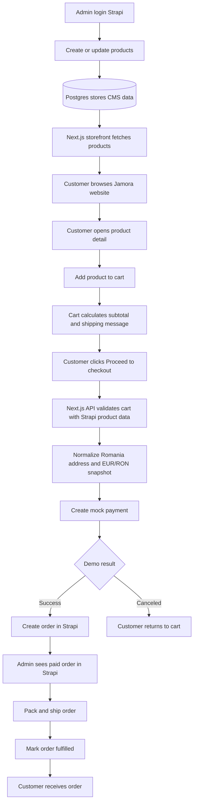
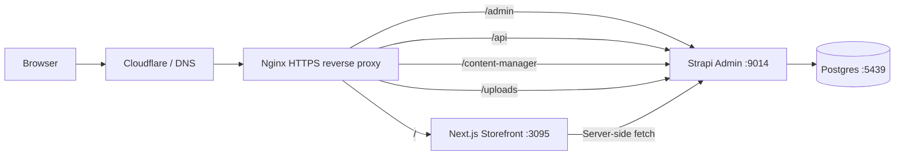
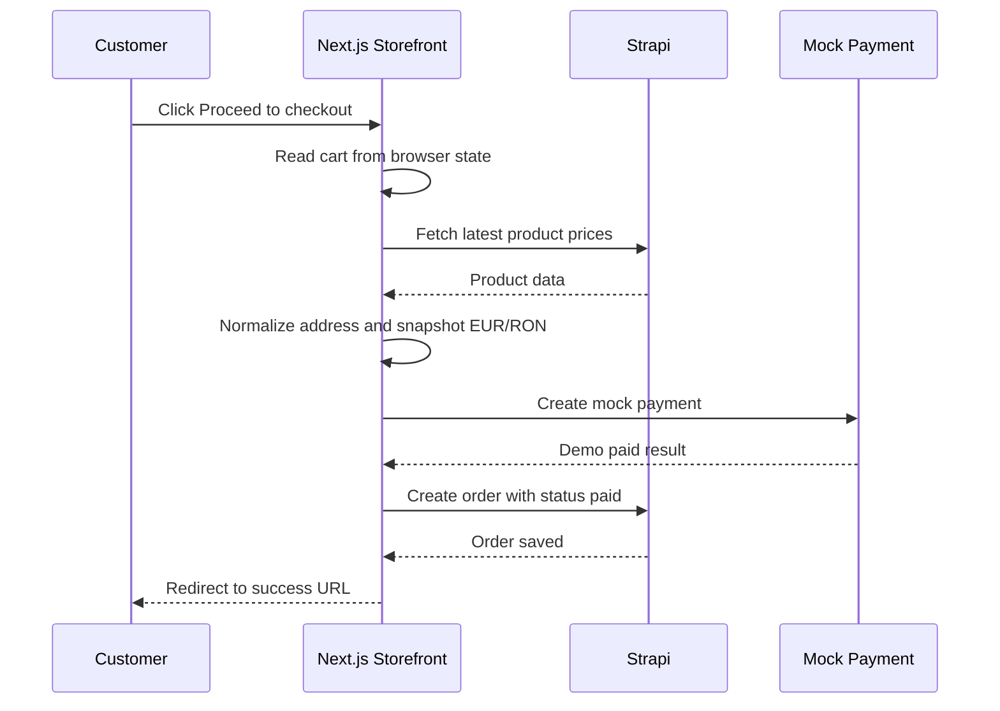

# Jamora - Business Flow & Flowchart

Dokumen ini menjelaskan alur bisnis Jamora dari sisi customer, admin, sistem,
payment, dan fulfillment. Stack saat ini:

| Layer | Tool | Fungsi |
| --- | --- | --- |
| Storefront | Next.js | Website customer, katalog, cart, checkout trigger |
| CMS / Admin | Strapi | Kelola produk, stok, konten, dan order |
| Database | Postgres | Simpan data CMS, produk, order |
| Payment | Bank transfer + RoPay mock adapter | Menyiapkan payment, mencatat receipt/callback terverifikasi, dan menyelesaikan order secara idempotent |
| Reverse Proxy | Nginx | Routing domain ke storefront dan Strapi |
| Analytics | Strapi + visit events | Visit, sales, omzet, estimated profit dashboard |

---

## 1. Business Flow Summary

1. Admin mengelola produk di Strapi.
2. Storefront mengambil data produk dari Strapi.
3. Customer browsing produk di website Jamora.
4. Customer menambahkan produk ke cart.
5. Customer klik checkout.
6. Storefront memvalidasi harga terkini dan alamat checkout.
7. Flow mock-paid membuat payment snapshot dan order demo.
8. Sistem menyimpan order dengan alamat Romania dan snapshot EUR/RON.
9. Guest tetap guest; account hanya dibuat melalui registrasi eksplisit.
10. Admin memproses order, packing, shipping, lalu update status.
11. Customer menerima konfirmasi order dan pengiriman.

---

## 2. Customer Flow

| Step | Actor | Action | System Result |
| --- | --- | --- | --- |
| 1 | Customer | Buka website Jamora | Next.js render halaman storefront |
| 2 | Customer | Lihat katalog / detail produk | Storefront fetch produk dari Strapi |
| 3 | Customer | Add to cart | Cart tersimpan di browser |
| 4 | Customer | Buka cart | Total dihitung dari item cart |
| 5 | Customer | Proceed to checkout | Storefront validasi cart dan alamat |
| 6 | Customer | Konfirmasi demo checkout | Mock payment diproses tanpa transaksi uang |
| 7 | System | Simpan hasil mock-paid | Sistem mencatat payment dan order paid di Strapi |
| 8 | Customer | Redirect ke success page | Customer melihat status order |

---

## 3. Admin Flow

| Step | Actor | Action | System Result |
| --- | --- | --- | --- |
| 1 | Admin | Login ke Strapi Admin | Admin masuk dashboard CMS |
| 2 | Admin | Kelola produk | Product data tersimpan di Postgres |
| 3 | Admin | Cek order baru | Order paid tampil di Strapi |
| 4 | Admin | Packing order | Status bisa diubah menjadi processing |
| 5 | Admin | Input shipment/tracking | Order siap dikirim |
| 6 | Admin | Mark fulfilled | Order selesai |

---

## 4. System Flow

### Current State

- Strapi sudah menjadi CMS utama.
- Storefront sudah fetch katalog dari Strapi.
- Cart sudah jalan di browser.
- Checkout Phase 0 memakai payment mock; tidak ada uang yang dipindahkan.
- Order demo tersimpan di Strapi. Payment live, callback provider, dan
  rekonsiliasi baru dijadwalkan pada Phase 2.

### Phase 0 Commerce Foundation

- Guest checkout memakai `anonymousSessionId` opaque dan tidak membuat customer
  account secara implisit.
- Customer account dibuat hanya dari registrasi. Email harus diverifikasi
  sebelum login; logout menghapus session; password reset menaikkan
  `sessionVersion` sehingga session sebelumnya tidak berlaku.
- Route account storefront: `/account/register`, `/account/verify`,
  `/account/login`, `/account`, `/account/forgot-password`, dan
  `/account/reset-password`.
- Consent dibedakan menjadi `necessary`, `analytics`, dan `lifecycle_email`.
  Setiap keputusan eksplisit dikirim melalui route browser-safe dan disimpan
  append-only sebagai satu row per purpose, lengkap dengan policy version,
  source, dan waktu keputusan. Penolakan/withdrawal menambah row `granted=false`
  baru; optional tracking tetap off.
- Checkout terstruktur menyimpan recipient, phone, ISO country code, county,
  locality, postal code, street, building, unit, instructions, serta formatted
  snapshot. Phase 0 menerima Romania (`RO`) saja.
- Nilai uang memakai integer minor units. Order menyimpan snapshot immutable:
  nilai referensi EUR, nilai checkout RON, rate, source, dan timestamp.
- Field order Phase 0 bersifat additive: `customerDocumentId`,
  `anonymousSessionId`, `shippingAddress`, `priceSnapshot`, dan
  `paymentDocumentId`; field legacy tetap dapat dibaca.
- `CUSTOMER_ACCOUNTS_ENABLED` dan `STRUCTURED_CHECKOUT_ENABLED` dapat dimatikan
  secara independen untuk kembali ke pengalaman lama.
- Di production, account customer tetap unavailable sampai Phase 6 menyediakan
  delivery verifikasi/recovery; kedua flag account dan delivery harus `true`.
- Proteksi abuse account saat ini memakai limiter IP + normalized account
  in-memory untuk satu proses Strapi. Deployment multi-instance memerlukan
  limiter distributed (misalnya Redis).

### Current Demo Checkout Flow

1. `POST /api/checkout` menerima cart items dari frontend.
2. API memvalidasi item dan harga dari Strapi, bukan percaya harga dari browser.
3. API menormalisasi alamat Romania dan membuat snapshot EUR/RON.
4. Mock payment dan order demo dibuat dengan status `paid`.
5. Customer diarahkan ke success page dan dapat mencari order yang sama dari
   halaman tracking.

Payment provider live dan webhook/callback terverifikasi belum tersedia di
Phase 0. Implementasi payment live dijadwalkan pada Phase 2.

---

## 5. Flowchart - End-to-End Business Flow



---

## 6. Flowchart - Technical Request Routing



---

## 7. Flowchart - Phase 0 Checkout Sequence



---

## 8. Order Status Lifecycle

| Status | Meaning | Current Phase 0 trigger | Future live-payment trigger |
| --- | --- | --- | --- |
| `pending` | Order intent created but not paid | Demo checkout starts | Payment request is created |
| `paid` | Payment accepted for order processing | Mock-paid flow marks the demo order paid | Verified provider callback or server-to-server status check |
| `failed` | Payment attempt failed | Manual admin update where needed | Verified provider failure/status result |
| `fulfilled` | Order shipped / completed | Manual admin update | Manual fulfilment or future shipping workflow |
| `refunded` | Refund recorded | Manual admin update only | Verified refund result plus immutable refund entry |

Phase 0 does not receive live payment callbacks or move real funds. A browser
redirect is never sufficient evidence for a future live payment.

---

## 9. Analytics Flow

1. Storefront loads a page.
2. `VisitTracker` sends a lightweight visit event to Strapi.
3. Mock paid checkout sends paid order data to Strapi.
4. Strapi aggregates visit events and paid/fulfilled orders.
5. Strapi Admin homepage widget displays:
   - total visits
   - visits today
   - sales count
   - omzet
   - today omzet
   - estimated profit
   - estimated margin

Estimated profit uses `JAMORA_COST_RATIO`. Example: `0.42` means estimated cost
is 42% of omzet, so estimated gross profit is 58%.

---

## 10. Phase 0 Checkout Environment

```bash
STRAPI_URL=http://strapi:1337
JAMORA_STOREFRONT_API_SECRET=change_me_storefront_to_strapi_secret
CUSTOMER_SESSION_TOKEN=change_me_customer_session_token
CUSTOMER_ACCOUNTS_ENABLED=false
STRUCTURED_CHECKOUT_ENABLED=false
JAMORA_COST_RATIO=0.42
```

Notes:

- `STRAPI_URL=http://strapi:1337` dipakai oleh storefront container untuk akses
  Strapi di jaringan Docker internal.
- Payment credential belum diperlukan karena Phase 0 tetap mock.
- Phase 2 akan menambahkan konfigurasi provider-neutral untuk manual bank
  transfer/RoPay dan callback terverifikasi. Provider lain dapat ditambahkan
  kemudian melalui interface payment yang sama.

---

## 11. Implementation Checklist

| Item | Status |
| --- | --- |
| Strapi CMS | Done |
| Product content type | Done |
| Product seed | Done |
| Storefront product fetch from Strapi | Done |
| Cart UI and local cart state | Done |
| Public product API access | Done |
| Mock paid checkout for testing | Done |
| Success / cancel pages | Done |
| Browser-based order tracking | Done |
| Strapi-backed order tracking | Done |
| Inventory stock field | Done |
| Stock decrement on mock paid checkout | Done |
| Simulated email confirmation | Done |
| Visit analytics capture | Done |
| Sales / omzet / profit Strapi widget | Done |
| Bank transfer + RoPay mock payment adapter | Done; flag-gated |
| Verified RoPay callback/status handling | Done for mock adapter; signed authority only |
| Finalize paid order from receipt/callback | Done; idempotent |
| Shipping/tracking fields | Later |

---

## 12. Phase 1 Membership Business Flow

Phase 1 adds prepaid memberships for verified customers while preserving the
ordinary guest and one-time checkout path.

1. An owner creates or updates a 3, 6, or 12 month plan, including integer EUR
   and RON prices, package-credit quantity, active state, and eligible products.
2. A verified customer purchases a plan. The Phase 1 payment boundary is a mock
   confirmation: it creates a pending membership, idempotently activates it,
   and posts exactly one `grant`. No real money moves in Phase 1.
3. The dashboard calculates remaining credits from the append-only ledger.
   `cachedRemainingCredits` is a repairable cache, never authoritative.
4. Redemption reserves stock and credits under one opaque checkout reference.
   Price, eligibility, stock, credit cost, and shipping are server-derived.
5. Credits cover eligible merchandise only. Shipping is always positive and
   customer-paid; free membership shipping is outside Phase 1.
6. Mock payment success creates the order and redeems the reservation.
   Payment/order or redemption failure releases stock and credits. Abandoned
   reservations are released by the bounded checkout expiry sweep.
7. At membership end, one idempotent expiry entry removes unused credits.
   Manual renewal creates a new period and grant without editing history.
8. Owner adjustments are append-only and require a signed delta, owner actor,
   and non-empty audit reason.

The additive schema includes `membership-plan`, `membership`,
`membership-credit-entry`, and `membership-checkout`; product membership fields
and order membership snapshots are additive too. Generated public ledger CRUD
is unavailable, and ledger update/delete is guarded.

`MEMBERSHIP_ENABLED` accepts only the exact string `true`. Any other value
returns 404 from storefront, owner BFF, controller, and direct service
boundaries. Disabling it is the rollback path: membership surfaces disappear,
ordinary guest/one-time checkout continues unchanged, and persisted membership
history remains intact for a later safe re-enable.

## 13. Phase 2 Payment Flow and Boundaries

Phase 2 adds manual bank transfer and a RoPay **mock adapter** behind a
provider-neutral payment interface. `ROPAY_PROVIDER_MODE=live` intentionally
fails closed: a real RoPay adapter has not yet been implemented or approved.

1. Storefront requests a payment using the shared storefront secret and either
   a validated customer session or the exact guest checkout capability.
2. Bank transfer persists a beneficiary snapshot, safe minor-unit amount,
   reference, and expiry. An owner records the receipt. Underpayment,
   overpayment, or currency mismatch is recorded but never settles anything.
3. Only an owner may resolve a mismatch as `accept` or `cancel`; the action
   requires an audit reason and idempotency key. An exact receipt settles once.
4. RoPay intent returns an ephemeral mock QR/deep link. Its callback or
   server-to-server status must carry a valid HMAC, fresh timestamp, matching
   provider reference, amount, currency, and immutable event identity. Replay
   of that event is idempotent.
5. A `paid` payment carries one settlement key: membership purchase/renewal
   activates and grants once; an ordinary order consumes its reservation and
   stock once. The resulting order timeline entry has `type: status` for
   tracking/admin consumers.
6. Browser RoPay return and payment-status endpoints are owner-bound reads;
   they do not open a transaction or mutate payment state. A late receipt or
   provider event cannot settle an expired payment.

`PAYMENTS_ENABLED` and `ROPAY_ENABLED` both require exact lowercase `true`.
When payments are disabled, public, owner, controller, and direct-service
payment boundaries fail closed. Disabling only RoPay preserves bank transfer.
These flags are the rollback: retain additive payment, payment-event,
membership, and order data; do not delete tables or immutable history.

Before enabling either flag, back up PostgreSQL and deploy the additive Strapi
schemas (`payment`, immutable `payment-event`, and additive order/membership
links). Money remains the stored safe integer minor-unit value plus currency
and immutable price snapshot; operators must never recalculate historical rows.
