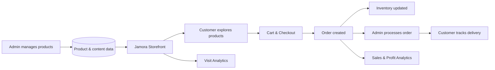

# JAMORA

## Core Feature Presentation

**Premium Indonesian Herbal E-Commerce for Europe**  
*Energi · Digestie · Echlibru*

---

## 1. Product Vision

Jamora membawa jamu premium Indonesia ke pasar Eropa melalui pengalaman belanja yang modern, informatif, dan terpercaya.

- Menggabungkan warisan herbal Indonesia dengan standar pasar Eropa
- Menempatkan transparansi produk sebagai bagian utama pengalaman pelanggan
- Menggunakan mata uang Euro (€) sebagai standar transaksi
- Dibangun sebagai platform commerce sekaligus media brand storytelling

---

## 2. Premium Storefront

Website customer dirancang untuk memperkenalkan brand dan memudahkan proses pembelian.

- Homepage dengan narasi dan identitas premium Jamora
- Katalog produk dengan tampilan responsif
- Halaman detail produk yang informatif
- Navigasi cepat dari eksplorasi produk hingga cart
- Server-side rendering untuk performa dan SEO yang lebih baik

**Value:** pelanggan dapat mengenal manfaat, kualitas, dan cerita produk sebelum membeli.

---

## 3. Three Wellness Pillars

Seluruh katalog disusun berdasarkan tiga kebutuhan utama pelanggan:

| Pillar | Fokus Manfaat |
| --- | --- |
| **Energy** | Mendukung energi dan vitalitas harian |
| **Digestion** | Mendukung kenyamanan dan kesehatan pencernaan |
| **Balance** | Mendukung keseimbangan tubuh dan gaya hidup |

Kategori ini digunakan secara konsisten pada katalog, navigasi, merchandising, dan analitik.

---

## 4. Transparent Product Information

Setiap produk dapat menyajikan informasi penting secara terstruktur:

- Komposisi dan transparansi bahan
- Manfaat utama produk
- Petunjuk konsumsi
- Informasi alergen
- Harga dalam Euro
- Status dan jumlah stok
- Badge sertifikasi seperti Organic, Vegan, EU Compliant, dan GMP

**Value:** meningkatkan kepercayaan pelanggan dan mendukung kebutuhan compliance pasar Eropa.

---

## 5. Cart & Checkout Experience

Alur pembelian dibuat sederhana dari katalog sampai konfirmasi order.

1. Customer memilih produk
2. Produk ditambahkan ke cart
3. Cart menghitung jumlah dan subtotal
4. Customer melanjutkan checkout
5. Sistem mencatat order dan menampilkan halaman konfirmasi

Cart tersimpan di browser sehingga item tetap tersedia saat customer berpindah halaman.

> **Current status:** alur checkout demo sudah tersedia. Manual bank
> transfer/RoPay dan callback provider terverifikasi belum diaktifkan.

Phase 0 adds a Romania-first checkout foundation:

- guest checkout stays available without implicit account creation;
- optional verified customer accounts support registration, login, logout, and
  password recovery;
- Romanian addresses are stored as structured fields plus a formatted snapshot;
- every new order captures immutable EUR reference and RON checkout values,
  including exchange rate source and timestamp;
- essential, analytics, and lifecycle-email consent are versioned separately,
  with optional categories off by default; every explicit choice is persisted
  append-only per purpose, including denial and later withdrawal.

Customer accounts and structured checkout have separate rollout flags, so
either feature can be disabled without disabling the other.

---

## 6. Content & Product Management

Admin dapat mengelola operasional toko melalui CMS dan dashboard internal.

- Membuat dan memperbarui produk
- Mengatur harga, kategori, deskripsi, dan media
- Mengelola konten storefront
- Melihat daftar produk dan detail order
- Mengubah status order sesuai proses operasional

Perubahan data tersimpan di database dan digunakan oleh storefront sebagai sumber data produk.

---

## 7. Inventory & Order Operations

Platform mendukung proses setelah customer melakukan checkout.

- Tracking stok setiap produk
- Pengurangan stok pada transaksi demo yang berhasil
- Monitoring order dari dashboard admin
- Status order untuk membedakan proses pembayaran dan fulfillment
- Halaman tracking agar customer dapat melihat perkembangan order
- Delivery label untuk membantu proses pengiriman

**Value:** operasional produk, order, dan pengiriman berada dalam satu alur yang terhubung.

---

## 8. Business Analytics

Jamora mencatat data kunjungan dan transaksi untuk memberikan ringkasan performa bisnis.

- Total visits dan visits hari ini
- Jumlah penjualan
- Total omzet dan omzet hari ini
- Estimasi gross profit
- Estimasi margin
- Visualisasi performa pada dashboard admin

Estimasi profit menggunakan rasio biaya yang dapat dikonfigurasi melalui `JAMORA_COST_RATIO`.

**Contoh:** cost ratio 42% menghasilkan estimasi gross margin 58% dari omzet.

---

## 9. Europe-Ready Foundation

Platform disiapkan untuk kebutuhan ekspansi ke pasar Eropa.

- English-first dengan fondasi multi-language
- Dukungan pilihan bahasa pada storefront
- Harga utama dalam Euro (€)
- Cookie consent untuk kebutuhan privasi
- Struktur data compliance dan sertifikasi produk
- Arsitektur headless yang mudah dikembangkan

Payment remains mock in Phase 0. Live bank transfer/RoPay integration and
verified provider callbacks are planned for Phase 2; browser success alone will
not be treated as proof of payment.

---

## 10. Core System Flow

---

## 11. Current Product Readiness

An overview of Jamora's core feature readiness based on the current implementation:

| Area | Status | Short Description |
| --- | --- | --- |
| Premium storefront | **Ready** | The customer website is responsive and reflects Jamora's premium brand identity. |
| Product catalog & detail | **Ready** | Customers can browse products, prices, information, and detailed product pages. |
| Three wellness categories | **Ready** | Products are organized into Energy, Digestion, and Balance categories. |
| Browser-based cart | **Ready** | Customers can add products and keep their cart saved in the browser. |
| CMS product management | **Ready** | Admins can create, update, and manage product information. |
| Inventory tracking | **Ready** | Product stock can be monitored and reduced after a successful demo transaction. |
| Order management & tracking | **Ready** | Admins can manage orders, while customers can check their order status. |
| Visit, sales, revenue & profit analytics | **Ready** | The dashboard displays visits, sales, revenue, and estimated profit. |
| Demo checkout flow | **Ready** | The checkout journey can be demonstrated without processing a real payment. |
| Guest + verified customer identity | **Automated verification complete; live smoke pending** | Guest orders require no account. Production accounts stay disabled until Phase 6 adds verification/recovery delivery. |
| Romania structured address | **Automated verification complete; live smoke pending** | Checkout can persist editable `RO` address fields and a formatted snapshot. |
| EUR/RON immutable price snapshot | **Automated verification complete; live smoke pending** | Orders retain integer minor-unit amounts, rate, source, and timestamp. |
| Versioned consent categories | **Automated verification complete; live smoke pending** | Necessary, analytics, and lifecycle-email decisions are persisted append-only per purpose; optional processing defaults off. |
| Bank transfer + RoPay mock adapter | **Automated verification complete; PostgreSQL/provider smoke required** | Flag-gated bank transfer receipts and signed RoPay mock callbacks settle idempotently. A real RoPay provider adapter is intentionally not enabled. |
| Prepaid 3/6/12-month membership | **Automated verification complete; dev-server live smoke required** | Owners configure plans and eligible packages; verified customers purchase through a Phase 1 mock payment boundary and renew manually into a new immutable period. |
| Append-only membership credits | **Automated verification complete; dev-server live smoke required** | Grant, reserve, release, redeem, expiry, and reasoned owner adjustments are auditable; dashboard balance is derived from the ledger. |
| Membership redemption checkout | **Automated verification complete; dev-server live smoke required** | Stock and credits reserve together, failure/expiry releases both, and a successful redemption charges customer-paid shipping while merchandise is credit-covered. |

---

## 12. Phase 1 Membership Readiness

Membership is independently controlled by `MEMBERSHIP_ENABLED`; only exact
`true` enables the storefront, owner, controller, and direct service surfaces.
Disabling the flag restores the existing one-time checkout experience without
deleting additive schemas or immutable membership history.

Phase 1 does not process real membership payments. Its mock confirmation proves
the pending-to-active, idempotent grant, dashboard, redemption, expiry,
adjustment, and manual-renewal boundaries. Live provider verification remains a
Phase 2 responsibility. Membership shipping is always customer-paid.

Automated tests, lint, and production builds are the completed implementation
gate. Local Docker/live smoke was waived; the documented live smoke on the dev
server must pass before any production promotion.

## 13. Phase 2 Payment Readiness

Phase 2 adds a provider-neutral payment foundation without treating a browser
success page as payment proof. Manual bank transfer stores an immutable amount,
currency, beneficiary snapshot, reference, and expiry. Exact owner-recorded
receipts settle once; amount/currency mismatches remain visible for a reasoned
owner decision and cannot activate a membership or order on their own.

RoPay currently uses a mock adapter. Intent returns a short-lived QR/deep-link
presentation, while only a signed callback or signed server-to-server status
message can settle it. HMAC verification binds the canonical event payload,
provider reference, timestamp, amount, and currency. Replays are idempotent;
bad signatures and expired events are rejected. Return/status pages are
owner-bound reads and do not mutate state.

`PAYMENTS_ENABLED` and `ROPAY_ENABLED` are independent exact-`true` rollout
flags. They provide configuration-first rollback while retaining additive
schemas and immutable payment event history. Payments can activate prepaid
memberships (one ledger grant) and finalize ordinary orders (reservation,
stock, promotion, invoice, and a `type: status` timeline entry) once.

Automated non-Docker tests, lint, and builds are required before deployment.
Docker was waived locally, but production promotion remains blocked on the
documented dev-server smoke against PostgreSQL and the actual provider callback
configuration. A real provider adapter must preserve these verification and
idempotency contracts before `ROPAY_PROVIDER_MODE=live` is ever supported.

## 14. Phase 3 Delivery Readiness

Phase 3 provides one accessible five-step checkout for guest, customer, and
membership orders. Romanian address suggestions reduce typing without
overriding manual edits or hiding postal/county/locality warnings. Delivery
prices, currency, carrier, service, weight, zone, estimate, and quote expiry are
owned and revalidated by Strapi.

Warehouse fulfillment is payment-bound and checklist-bound. A paid, packed
order receives one idempotent shipment, private PDF/ZPL label streaming, and an
AWB. Label capabilities are short-lived, shipment-specific, single-use, and
rotatable; browsers never receive provider credentials or permanent label
locations.

Tracking uses signed callbacks plus bounded fallback polling. The event ledger
is append-only, provider event IDs are replay-safe, and the explicit transition
table prevents status regression. Public tracking exposes a minimal projection
only after an order-bound random capability is presented. Missing/forged
capabilities, order-number-only queries, and AWB-only queries share the generic
not-found privacy surface.

| Phase 3 area | Readiness |
| --- | --- |
| Five-step guest/customer/member checkout | Automated verification complete |
| Romanian address suggestions + manual warnings | Automated verification complete |
| Authoritative RON quote/select snapshot | Automated verification complete |
| Paid/packed shipment creation | Automated verification complete |
| Private PDF/ZPL label capability | Automated verification complete |
| Signed, monotonic tracking + bounded polling | Automated verification complete |
| Legacy tracking capability reissue | Owner-only, bounded and audited; verified accounts only |
| Live carrier/PostgreSQL integration | Mandatory dev-server smoke pending |

`ADDRESS_PROVIDER_MODE=mock` and `SHIPPING_PROVIDER_MODE=mock` are the only
implemented adapter modes. Exact feature flags support immediate rollback
without deleting additive shipment/event fields. Docker was not used for the
local gate; the PostgreSQL, proxy, callback, label, polling, rate-limit, and
legacy-reissue runbook in `DEPLOYMENT.md` remains a production release blocker.

# JAMORA

### Indonesian Heritage. European Standard. Modern Commerce.

**Energi · Digestie · Echlibru**
